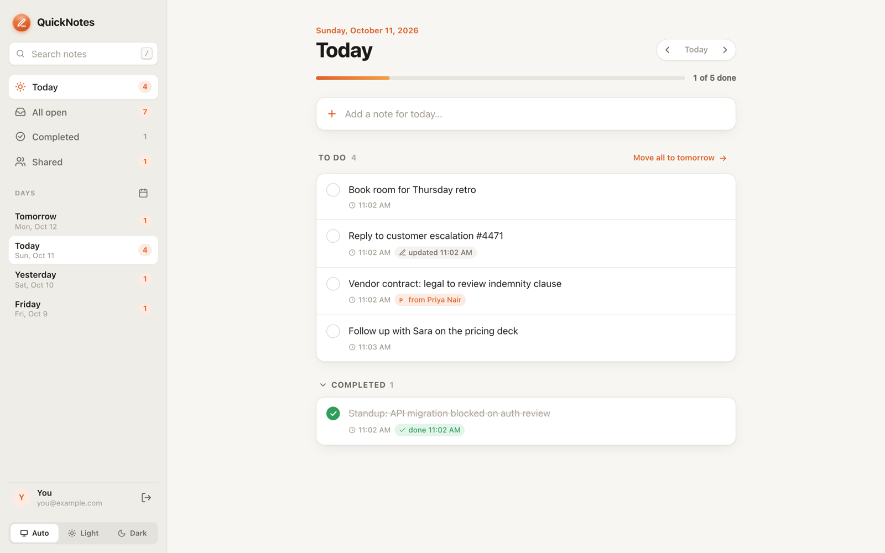
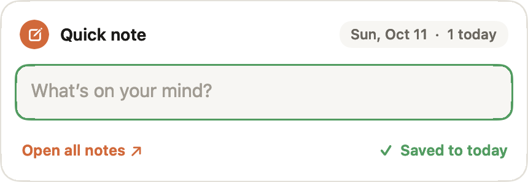
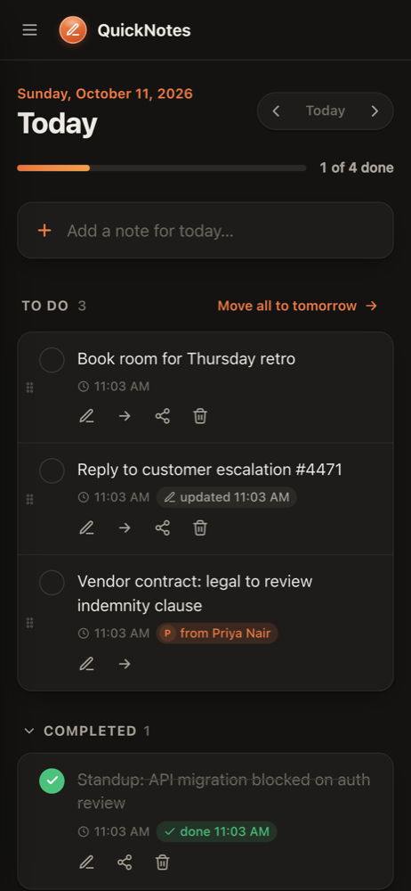
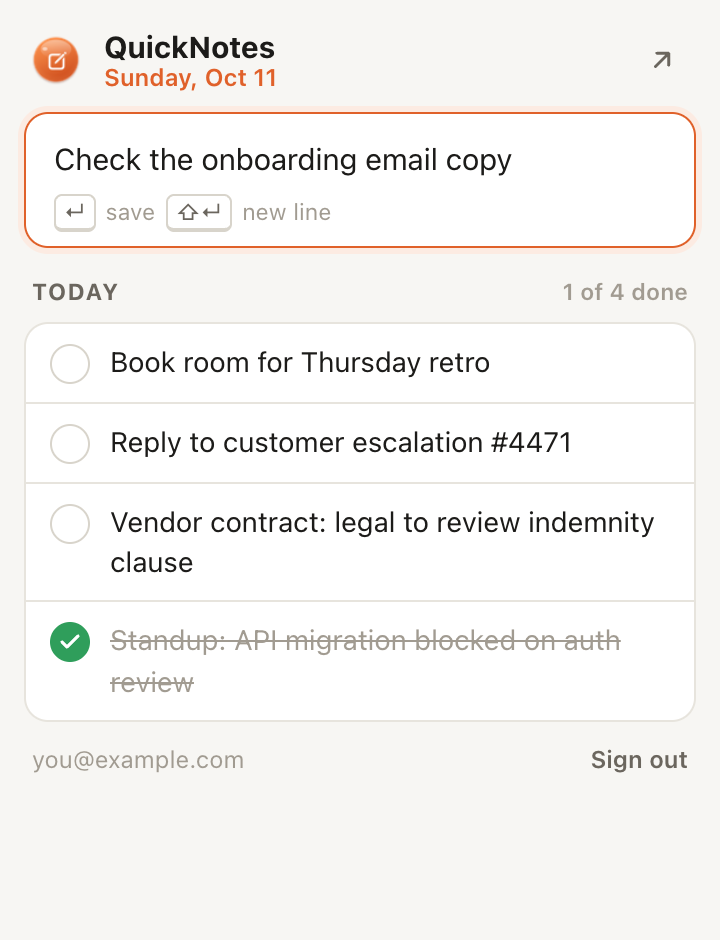
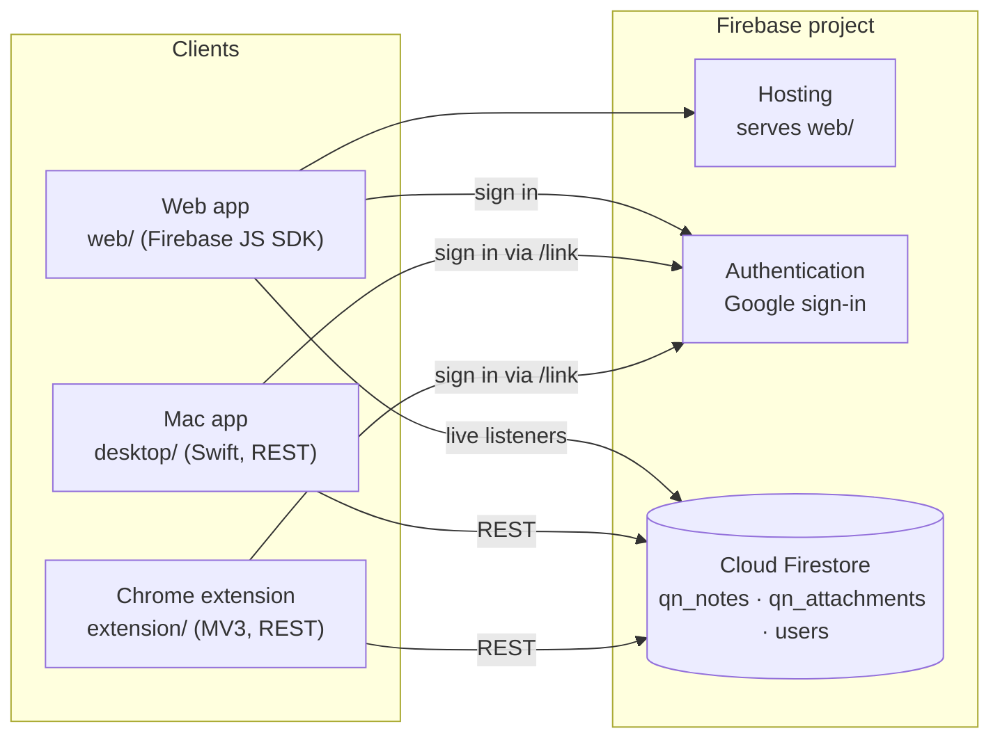

<p align="center"></p>

<h1 align="center">QuickNotes</h1>

<p align="center"><b>Capture what you need to act on, without leaving your meeting.</b><br>
Press <kbd>⌘</kbd><kbd>⇧</kbd><kbd>N</kbd>, type, hit <kbd>Enter</kbd>. Review, tick off, reorder and share it later on the web, your phone or in Chrome.</p>

<p align="center"></p>

---

## Contents

- [What's in the box](#whats-in-the-box)
- [How it fits together](#how-it-fits-together)
- [Repository layout](#repository-layout)
- [Requirements](#requirements)
- [Configuration & secrets](#configuration--secrets)
- [Quick start (using the existing QuickNotes backend)](#quick-start-using-the-existing-quicknotes-backend)
- [Run the web app locally](#run-the-web-app-locally)
- [Deploy](#deploy)
- [Use your own Firebase project](#use-your-own-firebase-project)
- [Data model & security](#data-model--security)
- [Demo video](#demo-video)
- [Troubleshooting](#troubleshooting)

---

## What's in the box

| | |
|---|---|
| **Mac bubble** <br> | A glossy orange bubble floats over every app and Space. Press **⌘⇧N** or **⌃⌥N** anywhere (or click the bubble), type a note, press **Enter**: it's saved to *today* and your meeting app never loses focus. Shift+Enter adds a line. **Screenshot notes:** press **⌃⌥S** and drag over any area (Space for a whole window), or **⌃⌥F** for the full screen (the display your pointer is on). Both are also under 📷 in the box. Add a description, press Enter. Works offline; notes and screenshots sync when you're back online. |
| **Web app** (desktop & phone) <br> | Notes grouped by day. Tick them off, edit, **drag to set priority**, move unfinished ones to tomorrow (one by one or all at once), search, **share a note with teammates by email**, and open screenshot notes full size. Light/dark theme, installable on a phone's home screen, offline-capable, live sync. |
| **Chrome extension** <br> | Toolbar popup (**⌥⇧N**) to add a note for today (optionally with a **screenshot of the current tab**) and tick off today's list. Right-click selected text, a link or a page → **Save to QuickNotes**. The icon badge shows today's open count. |

Everyone signs in with Google; the same notes appear everywhere.

## How it fits together



- There is **no custom server**. Firebase Hosting serves the static web app; all data rules live in [`firestore.rules`](firestore.rules).
- The **Mac app and extension** sign in by opening the web app's [`/link`](web/link.html) page in a sign-in window. It signs in with Google and hands a refresh token back only to the Mac app (`quicknotes://` callback) or to this extension's ID. They then talk to Firestore over REST.

## Repository layout

```
QuickNotes/
├── web/                     # the web app, deployed to Firebase Hosting
│   ├── index.html, styles.css, app.js   # UI
│   ├── store-firebase.js    # data layer: Firestore + Google sign-in (live)
│   ├── store-demo.js        # in-memory data for ?demo on localhost
│   ├── notes-model.js       # note shape + edit rules shared by both stores
│   ├── firebase-config.js   # generated from quicknotes.config.json (git-ignored)
│   ├── link.html, link.js   # sign-in page used by the Mac app & extension
│   └── manifest.webmanifest, icons/     # installable web app
├── desktop/                 # macOS app (Swift / AppKit, no Xcode project needed)
│   ├── main.swift           # bubble, hotkeys, menus, app lifecycle
│   ├── Capture.swift        # the quick-note box
│   ├── Screenshot.swift     # screen selection + JPEG compression for screenshot notes
│   ├── Cloud.swift          # sign-in, Firestore REST, offline queue
│   ├── Config.swift         # generated from quicknotes.config.json (git-ignored)
│   ├── BubbleArt.swift      # bubble drawing (also used for the app icon)
│   ├── icon/main.swift      # renders the app icon
│   └── Info.plist
├── extension/               # Chrome extension (Manifest V3)
│   ├── manifest.json        # includes the public key that pins the extension ID
│   ├── popup.html/css/js, background.js
│   ├── cloud.js             # sign-in + Firestore REST
│   └── config.js            # generated from quicknotes.config.json (git-ignored)
├── quicknotes.config.example.json   # template → copy to quicknotes.config.json (git-ignored)
├── scripts/configure.py     # writes each app's config + firebase.json/.firebaserc from it
├── firestore.rules          # database security rules
├── build.sh                 # builds the Mac app (+ extension zip); `install` installs both
├── deploy.sh                # deploys the web app + rules to Firebase
├── media/                   # tooling that generates the demo video
└── docs/images/             # screenshots for this README
```

## Requirements

| To… | You need |
|---|---|
| Use the web app | Any modern browser |
| Build the **Mac app** | macOS 13 Ventura or later, Apple Silicon or Intel, plus Xcode **Command Line Tools** (`xcode-select --install`). Full Xcode is not needed. |
| Load the **Chrome extension** | Google Chrome (or another Chromium browser) |
| Run the web app locally | Python 3 (preinstalled on macOS) or any static file server |
| **Deploy** / use your own Firebase | Node.js 18+ and the Firebase CLI: `npm install -g firebase-tools` |
| Regenerate the demo video | Node.js, Google Chrome, Command Line Tools |

## Configuration & secrets

No project keys or IDs are committed. Everything specific to a Firebase project lives in **one private file, `quicknotes.config.json`**, which is git-ignored:

```bash
cp quicknotes.config.example.json quicknotes.config.json
```

```jsonc
{
  "firebase": { "apiKey": "…", "authDomain": "<project-id>.firebaseapp.com", "projectId": "<project-id>",
                "storageBucket": "…", "messagingSenderId": "…", "appId": "…" },
  "webURL": "https://<site-id>.web.app/",        // where "Open all notes" goes
  "hostingSites": ["<site-id>"],                 // sites to deploy web/ to (the project's default site is always added)
  "extensionId": "jnndhbjfdfhoifgefnijcbglfilbjfia"  // Chrome extension allowed to receive sign-ins
}
```

- Get the `firebase` values from Firebase console → **Project settings → Your apps → Web app → SDK setup and configuration**. For the existing QuickNotes project, ask the project owner for the file.
- `scripts/configure.py` turns it into `web/firebase-config.js`, `extension/config.js`, `desktop/Config.swift`, `firebase.json` and `.firebaserc`. All of those are git-ignored too. `build.sh` and `deploy.sh` run it automatically; after editing the config, run `python3 scripts/configure.py` (or just build/deploy again).
- `.gitignore` also blocks private keys and certificates (`*.pem`, `*.p12`, …), `.env` files, service-account JSON and local sign-in files, so they can't be committed by accident.

> A website's Firebase config is visible to anyone who opens it; that's how Firebase web apps work. Keeping it out of Git stops it being scraped from GitHub, but what actually protects your data is [`firestore.rules`](firestore.rules). For extra safety, restrict the API key (see [Data model & security](#data-model--security)).

## Quick start (using the existing QuickNotes backend)

```bash
git clone <your-repo-url> QuickNotes
cd QuickNotes
cp quicknotes.config.example.json quicknotes.config.json   # then fill it in (see above)
xcode-select --install          # once, if `swiftc --version` fails
./build.sh install
```

`build.sh install`:
1. generates each app's config from `quicknotes.config.json`
2. compiles the Mac app to `build/QuickNotes.app` and copies it to `~/Applications/QuickNotes.app`, then launches it
3. copies the extension to `~/Applications/QuickNotes Chrome Extension/`
4. writes `build/quicknotes-chrome.zip` (a Chrome Web Store upload package)

Then:

- **Mac app**: on first launch it asks you to **Sign in with Google** (a browser sheet opens). Afterwards press **⌘⇧N** or **⌃⌥N** anywhere, or **⌃⌥S** / **⌃⌥F** for an area / full-screen screenshot note. The first screenshot asks for **Screen Recording** permission (System Settings → Privacy & Security → Screen & System Audio Recording → QuickNotes on, then reopen the app). Right-click the bubble for options (sign in/out, hide, swing, open at login).
- **Chrome extension**: open `chrome://extensions`, turn on **Developer mode**, click **Load unpacked**, and choose `~/Applications/QuickNotes Chrome Extension` (press ⌘⇧G in the picker and paste the path). Pin it, click the bubble icon, then **Continue with Google**.
- **Web / phone**: open **https://quicknotes-hq.web.app**. On iPhone use Share → *Add to Home Screen*; on Android use ⋮ → *Install app*.

> Built locally, the Mac app isn't quarantined, so macOS opens it without a warning. If you copy the `.app` to someone else, they'll need right-click → **Open** the first time, because the app isn't signed with an Apple Developer ID.

## Run the web app locally

```bash
python3 scripts/configure.py      # once, to generate web/firebase-config.js
cd web
python3 -m http.server 5599
```

- **http://localhost:5599/?demo**: sample data kept in memory, no sign-in. Good for UI work.
- **http://localhost:5599/**: the real app against Firebase. `localhost` is an authorized sign-in domain by default.

There is no build step: the web app is plain HTML/CSS/ES modules and loads the Firebase SDK from Google's CDN.

To try the extension popup's layout in a normal tab: `cd extension && python3 -m http.server 5598`, then open http://localhost:5598/popup.html (sample data).

## Deploy

You need access to the Firebase project (ask the owner to add you under *Project settings → Users and permissions*).

```bash
firebase login        # once
./deploy.sh
```

`deploy.sh` regenerates the config, then deploys the `web/` folder to every site in `hostingSites` plus the project's default site (which serves sign-in at `<project-id>.firebaseapp.com/link`), and publishes `firestore.rules`.

Changed the Mac app or extension? Run `./build.sh install` again, then click **reload** on the extension in `chrome://extensions`.

## Use your own Firebase project

To run a completely separate copy (a fork, or a staging environment):

**1. Create the project** at https://console.firebase.google.com. The free Spark plan is enough.

**2. Turn on the pieces:**
- **Authentication** → *Get started* → *Sign-in method* → **Google** → Enable.
- **Firestore Database** → *Create database* (production mode, any location).
- **Project settings** → *Your apps* → add a **Web app** and copy its `firebaseConfig`.

**3. (Optional) Pick a nicer web address:**
```bash
firebase hosting:sites:create my-quicknotes      # → https://my-quicknotes.web.app
```
Then add `my-quicknotes.web.app` under **Authentication → Settings → Authorized domains**.

**4. Point the code at your project:** put its values in `quicknotes.config.json` (see [Configuration & secrets](#configuration--secrets)). `authDomain` must stay `<project-id>.firebaseapp.com`. That's the only file to edit.

> **Why sign-in goes through `firebaseapp.com`:** Google only lets sign-in return to the redirect address registered when Google sign-in was switched on, which is `https://<project-id>.firebaseapp.com/__/auth/handler`. The Mac app and extension therefore open `/link` on that domain. To serve sign-in from your own domain instead, add `https://<your-domain>/__/auth/handler` to the OAuth client in Google Cloud Console → *APIs & Services → Credentials*, then set `authDomain` to that domain.

**5. Deploy and build:**
```bash
firebase login
./deploy.sh
./build.sh install
```

**About the Chrome extension ID.** `extension/manifest.json` contains a public `key`, which gives the extension a fixed ID (`jnndhbjfdfhoifgefnijcbglfilbjfia`) wherever it's loaded. The sign-in page only hands sign-ins to the ID in `extensionId`. You can keep it. If you want your own:

```bash
openssl genrsa -out extension-key.pem 2048           # keep this file private (it's git-ignored)
openssl rsa -in extension-key.pem -pubout -outform DER | base64     # → put into manifest.json "key"
openssl rsa -in extension-key.pem -pubout -outform DER | shasum -a 256 | head -c 32 | tr 0-9a-f a-p   # → the new ID
```
Put the new ID in `extensionId` in `quicknotes.config.json` and redeploy. A Chrome Web Store listing gets its own ID, which also has to go there.

## Data model & security

**`qn_notes/{noteId}`**: one document per note.

| Field | Notes |
|---|---|
| `ownerId`, `ownerEmail`, `ownerName` | who created it |
| `content` | the note (1–10,000 chars) |
| `note_date` | `YYYY-MM-DD` day it belongs to |
| `status` | `open` or `done` |
| `order` | priority within the day (lower = higher up); set by dragging |
| `created_at`, `updated_at`, `edited_at`, `completed_at` | ISO timestamps |
| `original_date`, `times_moved` | set when a note is moved to another day |
| `sharedWith` | emails the note is shared with |
| `attachment` | screenshot notes only: `{ id, kind: "screenshot", width, height, thumb }`; `thumb` is a small JPEG data URL |

**`qn_attachments/{id}`**: the full screenshot for a note (`ownerId`, `noteId`, `mime`, `data` = base64 JPEG, `width`, `height`, `created_at`). Screenshots are scaled to at most 2400 px and compressed to under ~700 KB so they fit a Firestore document, which keeps them on the free plan (no Cloud Storage needed). They live outside the note so the notes list stays fast, and are loaded only when opened. Deleting a note deletes its screenshot.

**`users/{uid}`**: one profile per person, written whenever someone signs in or opens an app.

| Field | Notes |
|---|---|
| `uid`, `email`, `displayName`, `photoURL`, `providers` | identity |
| `createdAt`, `lastSignInAt`, `lastSeenAt` | sign-up, last sign-in, last use |
| `visits` | number of times the web app has been opened |
| `locale`, `timeZone` | |
| `clients.web` / `clients.mac` / `clients.chrome` | per-app last use, version and device details |

**Rules** ([`firestore.rules`](firestore.rules)):
- A note can be read by its owner and the people in `sharedWith`. Those people can tick, edit, move and reorder it; only the owner can delete it or change who it's shared with.
- A screenshot (`qn_attachments`) can be read by its note's owner and the people the note is shared with; only the owner can create or delete it.
- A person can read and write **only their own** `users` document, and only the fields listed above. Anything you add later (e.g. `plan`, `role`) can therefore only be set by an admin.
- Everything else in the database is closed.

**Sign-in tokens on devices.** The Mac app keeps its session in `~/Library/Application Support/QuickNotes/session.json` (readable only by you), and notes waiting to upload in `pending.json` next to it. The extension stores its session in `chrome.storage.local`.

**About the API key in the code.** Firebase web API keys identify the project; they aren't secrets, and access is enforced by the rules above. For extra safety you can restrict the key in Google Cloud Console → *APIs & Services → Credentials* (e.g. limit it to the Identity Toolkit, Token Service and Firestore APIs).

## Demo video

`media/` holds the tooling that produced the 1-minute demo video with voiceover. The generated files are git-ignored; attach the video to a GitHub Release if you want to share it.

```bash
python3 scripts/configure.py
(cd web && python3 -m http.server 5599) &        # sample-data web app
(cd extension && python3 -m http.server 5598) &  # extension popup preview
node media/capture.mjs media/shots               # screenshots via a throwaway headless Chrome profile
swiftc -O -o /tmp/qn-frames media/capture-frames/main.swift desktop/Capture.swift desktop/BubbleArt.swift desktop/Screenshot.swift
/tmp/qn-frames media/shots/capture               # Mac quick-note frames
media/make_video.sh                              # voiceover (macOS `say`) + video → media/QuickNotes-demo.mp4
```

Edit the narration in `media/voiceover.txt` (one line per scene). Use another installed voice with `VOICE="Ava (Premium)" media/make_video.sh`.

## Troubleshooting

| Problem | Fix |
|---|---|
| Google says **"Access blocked: redirect_uri_mismatch"** | `authDomain` in `quicknotes.config.json` must be `<project-id>.firebaseapp.com` (see [Use your own Firebase project](#use-your-own-firebase-project)). |
| **"This web address isn't allowed to sign in"** (`auth/unauthorized-domain`) | Add the domain under Firebase **Authentication → Settings → Authorized domains**. |
| **"Google sign-in isn't switched on"** | Authentication → Sign-in method → enable **Google**. |
| Phone sign-in returns to the sign-in screen | Safari's privacy protection is getting in the way; use `https://<project-id>.firebaseapp.com` on the phone, or set up a custom `authDomain` as described above. |
| ⌃⌥S / ⌃⌥F screenshot only shows the desktop, or asks for permission | Turn on QuickNotes in System Settings → Privacy & Security → **Screen & System Audio Recording**, then quit and reopen it. After rebuilding the app from source you may need to switch it off and on again, because the unsigned app's identity changes with each build. |
| "Screenshot this tab" fails in Chrome | Chrome doesn't allow capturing its own pages (`chrome://…`, the Web Store, the PDF viewer). Any normal web page works. |
| ⌘⇧N doesn't open the bubble | Another app already uses it; ⌃⌥N still works. While QuickNotes runs, ⌘⇧N replaces that shortcut in other apps (e.g. Finder's *New Folder*). |
| The extension's ⌥⇧N doesn't work | Set it at `chrome://extensions/shortcuts`. |
| Notes typed in the bubble don't appear | Right-click the bubble. It shows whether you're signed in and how many notes are waiting to sync; they upload automatically when you're back online. |
| Old icon in the Dock | macOS caches icons; quit and reopen QuickNotes. |
| `swiftc: command not found` | `xcode-select --install` |
| **"Missing quicknotes.config.json"** | `cp quicknotes.config.example.json quicknotes.config.json` and fill it in. |
| A build or deploy uses old project values | Run `python3 scripts/configure.py` (build/deploy do this automatically). |
| **Uninstall** | Quit QuickNotes; delete `~/Applications/QuickNotes.app`, `~/Applications/QuickNotes Chrome Extension` and `~/Library/Application Support/QuickNotes`; remove the extension in `chrome://extensions`. |

---

<sub>Built with Swift/AppKit, vanilla JavaScript and Firebase (Hosting, Authentication, Cloud Firestore). No frameworks, no build step for the web app.</sub>
